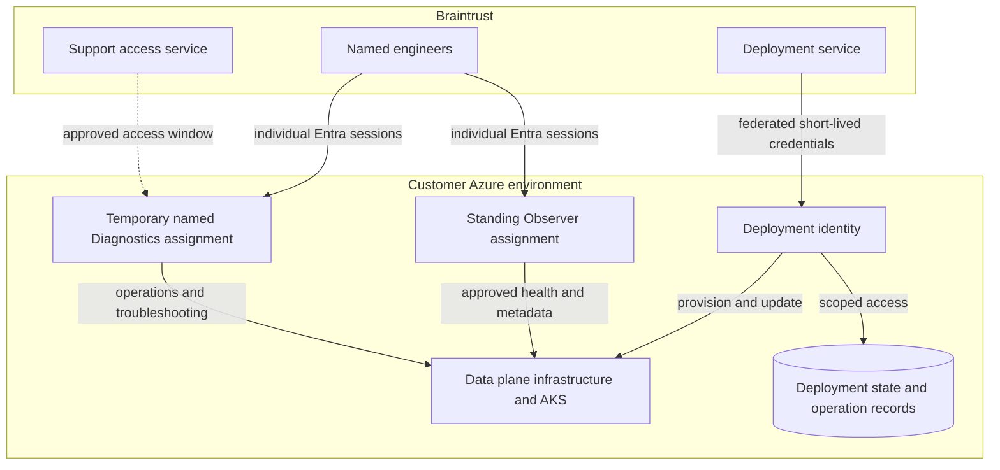

# Azure managed BYOC access model

**Status: design preview · Work in progress.** This is an architecture review
reference. The proposed identities, permissions, and access lifecycle require
implementation and live validation before use. This preview contains no
installable bootstrap, role definitions, or guardrail policies.

For the operating model, data flows, and shared responsibilities, see
[Braintrust BYOC](https://docs.braintrust.dev/admin/deployment/byoc).
This package focuses on the proposed Azure deployment and access patterns.
We welcome infrastructure and security feedback on these boundaries.

## Start here

| To review | Read |
| --- | --- |
| Access model and trust limits | This page |
| Deployment identity, engineer sign-in, and onboarding | [Identity guide](identity.md) |
| Preferred PIM pattern and ordinary RBAC alternative | [Diagnostics guide](diagnostics.md) |

## Deployment boundary

The proposed model uses a dedicated Azure subscription in the customer's Entra
tenant. Permissions are scoped to the agreed resource groups, cluster resources,
and deployment storage. The existing Terraform module provides the infrastructure
foundation, including AKS, networking, and data services; Helm configures the
application layer. The managed access model described here is additional work.
Use of an existing network or AKS cluster requires separate access and
connectivity validation.

## Roles and access

The following are proposed access profiles, not published Azure role definitions.

| Access profile | Purpose | Intended access |
| --- | --- | --- |
| Deployment | Automated infrastructure and application lifecycle | Privileged management of the deployment, required state, and service configuration |
| Observer | Standing human inspection | Approved health, metrics, and metadata; excludes application content, sensitive configuration, secrets, state, and shell access |
| Diagnostics | Temporary human operations and troubleshooting | Approved operational changes, application logs, sensitive configuration, and workload sessions |

Deployment and human support use separate identities. Runtime workload identities
remain distinct from both. The preferred Diagnostics design uses Azure Privileged
Identity Management (PIM) to expire named assignments; ordinary RBAC with
Braintrust-managed removal remains an alternative. Observer stays assigned in
either pattern.

## Customer controls and important limits

- **Reviewable access:** customer-approved onboarding establishes the trusted
  identities, scopes, deployment storage, and audit requirements. New permission
  requirements need a reviewed update.
- **Privileged deployment:** automation can change workloads that access data.
  Narrow permissions do not eliminate that trust relationship.
- **Sensitive Diagnostics:** operational access can read or modify application
  data through logs, configuration, and running workloads.
- **Independent customer control:** customer administrators retain recovery and
  revocation authority. Durable revocation must also prevent automation from
  recreating grants.
- **Separate safeguards:** scoped Azure permissions, customer-owned policy,
  retention, and audit controls need service-specific validation. Azure Policy
  and resource locks are not universal data-access or deletion barriers.
- **Explicit isolation:** deployments sharing identities or access scopes share
  that permission boundary. Names and resource prefixes alone do not isolate them.

## Preview change history

| Date | Change | What to review |
| --- | --- | --- |
| 2026-11-06 | Initial Azure architecture preview. | Federated deployment identity, group-managed human eligibility, standing Observer, named Diagnostics, and PIM versus ordinary RBAC. Implementation and effective access remain unvalidated. |
