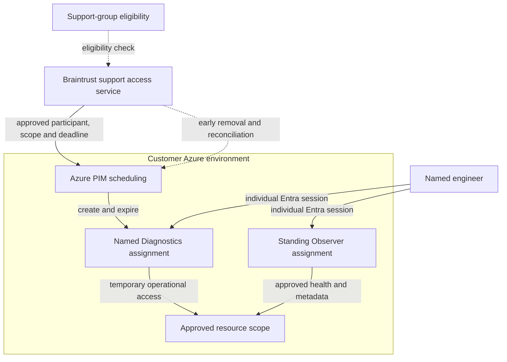

# Temporary Diagnostics access

[Back to overview](README.md#start-here)

**Status: design preview · Work in progress.** PIM scheduling is the preferred
design to validate. Ordinary RBAC remains an alternative. Neither pattern is an
implemented access contract in this package.

Diagnostics permits approved operational changes and troubleshooting. It can
expose or modify application data through logs, configuration, or running
workloads, including interactive sessions.

## Common access lifecycle

- Braintrust verifies the named engineer's current support eligibility and the
  applicable customer approval or advance-notice requirements. Standing approval
  can cover work within its agreed scope.
- The grant connects that engineer's customer Entra identity, the predefined
  Diagnostics permission set, and the approved resource scope. The proposed
  default window is two hours. Extensions and participant changes are explicit.
- The permission definition stays fixed. Activation changes the assignment, not
  the role's permissions or the engineer's workforce membership.
- Braintrust records the authorizing actor, participant, reason, scope, approval
  reference, start, expiry, extensions, and closure result.
- Standing Observer remains assigned before, during, and after Diagnostics.

Approval is part of Braintrust's access workflow. This preview does not claim an
independent technical customer-approval gate that Braintrust cannot bypass.

## Preferred pattern: PIM scheduling

Braintrust's support access service requests an active, time-limited Azure
resource-role assignment for the approved engineer. The engineer uses their
existing Entra sign-in; no separate PIM self-activation is required by this design.

Once accepted, Azure owns the assignment's expiry even if Braintrust's access
service is unavailable. Braintrust still handles approval and notification,
early removal, approved extensions, and verification of the resulting grant state.
This uses PIM for Azure resource roles, separate from directory-role or group
membership administration. PIM licensing and assignment policy must support the
selected pattern. See [time-bound Azure roles](https://learn.microsoft.com/en-us/azure/role-based-access-control/pim-integration)
and [the PIM API model](https://learn.microsoft.com/en-us/entra/id-governance/privileged-identity-management/pim-apis).

Adoption requires proving that activation authority is limited to the intended
Diagnostics role and scopes, without general access administration. Azure RBAC
delegation, customer-owned Azure Policy, and PIM assignment-expiration settings
are being evaluated together. Ordinary role-assignment restrictions cannot be
assumed to protect scheduling requests identically. Their exact enforcement
remains an open security question. Microsoft documents
[Policy restrictions on scheduling](https://learn.microsoft.com/en-us/azure/role-based-access-control/pim-integration#how-to-limit-the-creation-of-eligible-or-time-bound-role-assignments),
but that does not establish this design's complete permission boundary.

## Alternative: ordinary RBAC

Braintrust creates the named engineer's Diagnostics assignment and removes it at
the recorded deadline or on early closure. The identity path, permissions,
approval evidence, and standing Observer assignment remain the same.

Ordinary assignments have no native scheduled expiry. Durable timers, retries,
and overdue-grant monitoring therefore belong to Braintrust. Loss of the access
service or its authority can leave a grant active beyond its intended window.

| Boundary | PIM scheduling | Ordinary RBAC |
| --- | --- | --- |
| Active participant | Named engineer | Named engineer |
| Deadline enforcement | Azure assignment schedule | Braintrust removes the assignment |
| Early closure | Request removal and verify state | Delete assignment and verify state |
| Main validation question | Narrow scheduling authority and effective expiry | Narrow assignment authority and reliable removal |

Both designs require a current eligibility check. A direct grant does not
automatically disappear when an engineer leaves the support group; lifecycle
reconciliation must account for active windows. Azure-enforced restriction to a
changing support cohort remains a separate design question.

## Expiry, evidence, and customer revocation

Assignment removal or expiry can take time to affect authorization. Existing
credentials and established connections follow native service behavior. Routine
closure does not proactively invalidate tokens or terminate sessions; a two-hour
grant is not a guaranteed two-hour maximum shell duration.
See [Azure authorization propagation](https://learn.microsoft.com/en-us/azure/role-based-access-control/troubleshooting).

Customer-visible assignments, Azure Activity Log, configured service audit logs,
and Braintrust operation records provide complementary evidence. API audit logs
are not complete command/output transcripts. AKS audit coverage and any required
session recording must be validated before enabling interactive access.

Customers retain independent authority to remove grants and revoke Braintrust's
ability to recreate them. Emergency cutoff must account for active credentials,
connections, and authorization propagation, using a customer recovery path that
does not depend on Braintrust access.

## Review priorities

Validate named-engineer isolation, Observer exclusions, restricted activation
authority, expiry during service outages, early removal, offboarding, audit
coverage, and customer revocation. The choice of PIM or ordinary RBAC remains
open until these checks establish the intended boundary.
