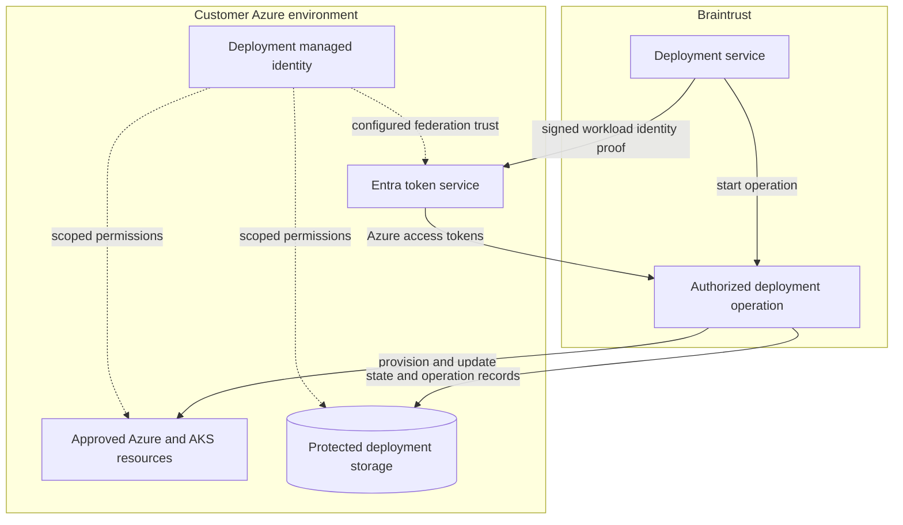

# Deployment and identity

[Back to overview](README.md#start-here)

**Status: design preview · Work in progress.** These are proposed trust and
deployment patterns. Permission definitions and bootstrap implementation are
outside this preview.

## Deployment identity

The proposed model uses a customer-owned user-assigned managed identity dedicated
to the customer deployment boundary. Microsoft Entra workload identity federation
exchanges proof of an approved Braintrust workload identity for short-lived Azure
access tokens. This avoids storing a customer client secret in Braintrust's
deployment service.

The intended boundary is the exact trusted workload identity, tenant, and assigned
resource scopes. Deployment receives the permissions needed for Terraform and Helm
operations. Runtime identities receive their own service permissions. Support
activation authority is kept separate from deployment execution.

Azure permissions set the identity's access ceiling. An operation identifier
supports audit correlation; it does not independently narrow those permissions.
Federation also does not establish network connectivity: access to private AKS
and service endpoints requires a reviewed network and DNS path.

Token renewal across long operations, separation between customer deployments,
and behavior after trust or permission removal require validation. Stopping new
token issuance does not immediately invalidate previously issued credentials.
See [Microsoft's federation overview](https://learn.microsoft.com/en-us/entra/workload-id/workload-identity-federation).

## Named engineer access

Braintrust engineers authenticate through the Braintrust workforce identity
provider and a Braintrust Entra home identity. Customer Entra B2B collaboration
represents each engineer individually in the customer tenant. The customer
applies its external-access, MFA, and device requirements.

Braintrust maintains support-group eligibility centrally. The proposed onboarding
integration provisions and removes the corresponding customer-tenant identities
and group memberships; its lifecycle and licensing need validation. Bootstrap
configuration references stable groups, not a maintained list of engineers.

Observer is assigned to the approved support group. A Diagnostics request selects
an eligible engineer and resolves that person to their customer-tenant identity.
The temporary grant is individual, so opening a window does not elevate the
entire support group. Opening or closing that window does not change workforce
assignments or group membership. See [Diagnostics](diagnostics.md) and
[Entra cross-tenant controls](https://learn.microsoft.com/en-us/entra/external-id/cross-tenant-access-overview).

## Onboarding and authorization

Directory administrators approve the external identity relationship and lifecycle
integration. Subscription administrators approve resource roles and scopes.
These can form one guided onboarding process, but subscription ownership alone
does not authorize directory administration.

AKS access must preserve individual attribution and enforce the intended
permissions without shared administrator credentials. Azure management access
and Kubernetes authorization require separate review.

Observer needs a tested allowlist. Generic Reader access, broad read permissions,
or the absence of data-plane permissions do not prove that sensitive content is
inaccessible. Review logs, resource configuration, inherited grants, and
Kubernetes access together before accepting the profile as data-blind.
See [Azure log-access behavior](https://learn.microsoft.com/en-us/azure/azure-monitor/logs/manage-access).
